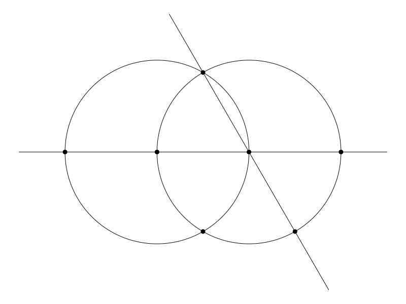
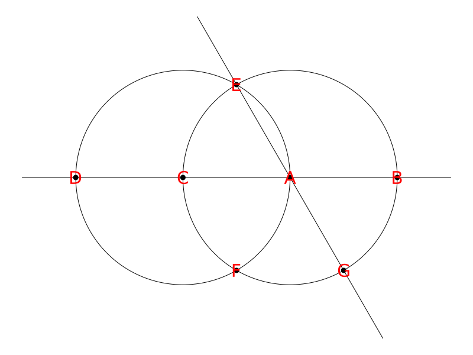

# Constructibles

This module provides tools for compass and straightedge constructions. The sections below are as follows:
* **Constructible Numbers**: Possible distances between points in a construction.
* **Construcible Objects**: Points, lines, and circles that can be constructed with straightedge and compass.
* **Construction Drawings**: Interactive compass and straightedge constructions.

## Constructible Numbers

*Constructible numbers* are an extension of the rational numbers. They can be defined recursively as follows:
* Integers are constructible.
* The sum, difference, product, and quotient of constructible numbers are constructible (division by zero is forbidden).
* The square root of a nonnegative constructible number is constructible. In this implementation, all constructible numbers are real.

Constructible numbers are exactly the lengths that can be constructed using straightedge and compass (and an initial pair of points unit distance apart). 

This `Constructibles` module provides the the `ConstructibleNumber` type for working with constructible numbers.

> We provide the abbreviation `CN` for `ConstructibleNumber` (because it's a lot to type).

### Basics

Starting with an `Integer` or a `Rational`, we create a `ConstructibleNumber` like this:
```
julia> a = CN(5)
5

julia> b = CN(2//3)
2/3

julia> typeof(b)
ConstructibleNumber
```

The standard operations of addition, subtraction, multiplication, division, and square root can be applied to these numbers to build more elaborate constructible numbers:

```
julia> sqrt(a-b) + 5/sqrt(CN(7))
5*sqrt(7)/7 + sqrt(39)/3

julia> phi = (1+sqrt(CN(5)))/2
1/2 + sqrt(5)/2

julia> phi^2 - phi - 1
0
```

### Conversion

Use `float` or `Float64` to convert a `ConstructibleNumber` to a `Float64`:
```
julia> float(phi)
1.618033988749895
```

To render a `ConstructibleNumber` in LaTeX form use the `latex` function:
```
julia> latex(phi)
"\\frac{1}{2} + \\frac{\\sqrt{5}}{2}"

julia> println(latex(phi))
\frac{1}{2} + \frac{\sqrt{5}}{2}
```
So `phi` is $\frac{1}{2} + \frac{\sqrt{5}}{2}$.

## Constructible Geometric Objects

We define the abstract type `ConstructibleObject` (or `CO` for short) that has three subtypes:
* `ConstructiblePoint` (or `CP` for short)
* `ConstructibleCircle` (or `CC` for short)
* `ConstructibleLines` (or `CL` for short)

### Points

A *constructible point* is a point in the plane whose $x$ and $y$ coordinates are both constructible. These have type `ConstructiblePoint`, or `CP` for short.

* `CP(x,y)` creates a new point at coordinates `(x,y)`. 

The distance between points `A` and `B` is returned by `dist(A,B)`.

### Circles

A *constructible circle* is a circle in the plane whose center is a constructible point and whose radius is a constructible number. These have type `ConstructibleCircle`, or `CC` for short.

* `CC(P,r)` creates a new circle centered at the point `P` with radius `r`. An error is thrown if the radius is negative. 
* `CC(P,A)` creates a new circle centered at the point `P` that passes through the point `A`.

The center of a constructible circle `Z` is returned by `center(Z)` and its radius by `radius(Z)`.

### Lines

A *constructible line* is a line in the plane whose equation is of the form $ax+by+c=0$ where the coefficients are constructible numbers (not all zero). 
These have type `ConstructibleLine`, or `CL` for short.

* `CL(a,b,c)` creates the line with equation $ax+by+c=0$. An error is thrown if `a`, `b`, and `c` are all zero. 
* `CL(A,B)` creates the line that includes the points `A` and `B`. An error is thrown if `A` and `B` are the same point. 

> *Note*: A line determined by `(a,b,c)` is exactly the same as the line determined by any nonzero multiple of `(a,b,c)`. Internally we scale these parameters so the rightmost nonzero element is `1`. So `CL(1,2,3)` is stored as as `CL(1/3, 2/3, 1)`.

### Incidence

If `A` is a point and `X` is either a line or a circle, then `in(A,X)` (or `A ∈ X`) returns `true` if `A` lies on `X`. 

### Intersection

The intersection of two lines, two circles, or a line and a circle results in a list of constructible points. That list might have 0, 1, or 2 members. 

If `X` and `Y` are circles and/or lines, then `intersect(X,Y)` (or `X ∩ Y`) returns a list of points that are in both `X` and `Y`. 

```
julia> X = CC(0,0,1)  # radius 1 circle centered at the origin
CC((0, 0), 1)

julia> Y = CC(1,0,1)  # radius 1 circle centered at (1,0)
CC((1, 0), 1)

julia> X ∩ Y
2-element Vector{ConstructiblePoint}:
 CP(1/2, -sqrt(3)/2)
 CP(1/2, sqrt(3)/2)
```


## Construction Drawings

A straightedge and compass construction begins with two points, `A` and `B`, that are a unit distance apart. 
* The straightedge can be used to create a line between two established points. 
* The compass can be used to create a circle centered at an established point and passing through another establisehd point, or centered at an established point using the distance between two established points as its radius.

Wherever we have there is an intersection of two of these shapes, a new point is established.

The functions `ruler` and `compass` instantiate this process (see below).

### Point names

The points in a construction drawing are named by Julia symbols. The first two points are automatically `:A` and `:B` which correspond to the point `CP(0,0)` and `CP(1,0)`, respectively. 

Points are created at the intersection of new lines/circles with the existing lines/circles. The new points are automatically named `:C`, `:D`, and so on. (In case the drawing has more than 26 points, the naming contiues with doubled letters: `:AA`, `:BB`, etc.)

### Interactive drawing

The function `ruler` (a straightedge) creates lines and `compass` creates circles. The arguments to both are symbolic names of points; that is, `:A` is the input used to refer to point `A` in the construction.

* `ruler(:A, :B)` draws a line between the points `A` and `B`.
* `compass(:A, :B)` draws a circle centered at `A` and passing through `B`.
* `compass(:A, :B, :C)` draws a circle centered at `A` whose radius is the distance between points `B` and `C`. 

As lines and circles are added to the construction, new points are identified at the intersections of the added object and the objects already in the construction. The image is updated after each `ruler` or `compass` call. 

#### Getting started 

Initially, there are only two points in the construction, `A` and `B`, and they are distance one apart. [The coordinates of these points are `(0,0)` and `(1,0)`, respectively.] The only options available to the user at this point is one of the following:

* `ruler(:A, :B)`
* `compass(:A, :B)`
* `compass(:B, :A)`

After each command, the display is updated to show the new objects and any new points that are identified. 

The `restart!` function is used to [re]initialize a construction. 

> **Warning!** Using `restart!()` will delete any prior construction and leave a new construction with just the points `A` and `B`.

#### Labels

A construction typically shows only points, lines, and circles, but not the names of the points. Use `show_labels()` to have the names of the points displayed. The `redraw()` command will redraw the display without the labels. Also, any subsequent call to `ruler` or `compass` will also hide the labels. 

#### Object information

The function `display_points()` prints a list of points and their coordinates. The function `display_objects()` prints a list of lines and circles. 

### Example

We illustrate doing a construction with these interactive commands:
```
restart!()
compass(:A, :B)
ruler(:A, :B)
compass(:C, :A)
ruler(:A, :E)
```

This is the result:



Here is the same construction after `show_labels()`:



The list of points:
```
julia> display_points()
A       CP(0, 0)
B       CP(1, 0)
C       CP(-1, 0)
D       CP(-2, 0)
E       CP(-1/2, sqrt(3)/2)
F       CP(-1/2, -sqrt(3)/2)
G       CP(1/2, -sqrt(3)/2)
```

The list of lines and circles:
```
julia> display_objects()
CL(0, 1, 0)
CL(sqrt(3), 1, 0)
CC((0, 0), 1)
CC((-1, 0), 1)
```